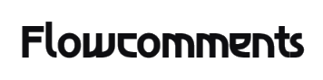

<p align="center">
  <picture>
    <source media="(prefers-color-scheme: dark)" srcset="docs/assets/flowcomments-logo-white.png" />
    
  </picture>
</p>

<p align="center">
  <strong>Automatize comentários e DMs do Instagram.</strong><br />
  Alternativa self-hosted e source-available ao ManyChat.
</p>

<p align="center">
  <a href="https://flowcomments.com"></a>
  <a href="./LICENSE"></a>
  <a href="./CHANGELOG.md"></a>
  <a href="./CONTRIBUTING.md"></a>
</p>

> **Licença:** Flowcomments Sustainable Use License (source-available / fair-code, não é OSI open source).  
> Veja [LICENSE](./LICENSE) e [flowcomments.com/license](https://flowcomments.com/license).

**Site oficial / Cloud:** [flowcomments.com](https://flowcomments.com) · **ManyChat alternative:** [flowcomments.com/alternatives/manychat](https://flowcomments.com/alternatives/manychat)

## Apoie o projeto (doação)

Self-host é **gratuito** na sua infra. Se o Flowcomments te ajuda, uma doação pontual via Stripe sustenta docs, updates e o core público:

**[Doar no site oficial →](https://flowcomments.com/self-host#donate)**

Valores sugeridos: $5 · $15 · $50 (Checkout Stripe). Cloud hospedado: [R$ 197/mês](https://flowcomments.com/signup) (BR) · $67/mo (intl).

## O que é o Flowcomments?

Plataforma self-hosted para automatizar interações no Instagram:

- **Automações inteligentes** — responda comentários com base em palavras-chave
- **DMs automáticos** — envie mensagens diretas após comentários
- **Gestão de contatos** — organize seguidores e acompanhe interações
- **Inbox unificado** — todas as conversas em um só lugar
- **Self-hosted** — controle total dos seus dados
- **Source-available** — código disponível para auditoria e customização

## Quick Start

### Docker Compose (recomendado)

```bash
git clone https://github.com/NathanConde-dev/flowcomments.git
cd flowcomments
cp .env.example .env
# Defina ENCRYPTION_KEY e SESSION_SECRET
docker compose up -d
```

Abra [http://localhost:3000](http://localhost:3000), complete o wizard e conecte o Instagram.

### Railway (1-Click Deploy)

[](https://railway.com/deploy/flowcomments-template)

### VPS (Hostinger, DigitalOcean, etc.)

Veja o guia completo em [docs/RAILWAY_DEPLOY.md](./docs/RAILWAY_DEPLOY.md) e a seção VPS abaixo no histórico de docs, ou o [guia oficial de self-host](https://flowcomments.com/self-host).

Resumo mínimo:

```bash
git clone https://github.com/NathanConde-dev/flowcomments.git
cd flowcomments
cp .env.example .env
npm install
npx prisma migrate deploy
npm run build
npm start
# em outro processo:
npm run worker
```

## Meta App (Instagram)

Resumo: crie um app em [Meta for Developers](https://developers.facebook.com/), adicione Instagram API + Webhooks, permissões `instagram_basic`, `instagram_manage_comments`, `instagram_manage_messages`, `pages_show_list`, `pages_read_engagement`, e aponte o webhook para `https://seu-dominio.com/api/webhook`.

Guia passo a passo (humano + IA): [docs/ai/SETUP_PROMPT.md](./docs/ai/SETUP_PROMPT.md) · [flowcomments.com/guides/first-automation](https://flowcomments.com/guides/first-automation)

## Atualizações e comunicados

Este repo é **só a plataforma** (sem landing de marketing). A landing oficial fica no Cloud.

No painel: **Novidades / What's new** — changelog GitHub, update opt-in ([docs/UPDATES.md](./docs/UPDATES.md)) e comunicados via `FLOWCOMMENTS_CONTROL_PLANE_URL`.

SaaS + landing: [flowcomments.com](https://flowcomments.com). Detalhes: [docs/CLOUD_VS_SELFHOST.md](./docs/CLOUD_VS_SELFHOST.md).

> Self-host para uso próprio: permitido. Revender como SaaS/assinatura concorrente: **proibido** pela [LICENSE](./LICENSE).

## Desenvolvimento

```bash
npm install
docker run --name flowcomments-db -e POSTGRES_PASSWORD=flowcomments -e POSTGRES_DB=flowcomments -p 5432:5432 -d postgres:16-alpine
docker run --name flowcomments-redis -p 6379:6379 -d redis:7-alpine
cp .env.example .env
npx prisma migrate dev
npm run dev
# outro terminal
npm run worker
```

| Script | Descrição |
|--------|-----------|
| `npm run dev` | Dev server |
| `npm run build` | Build produção |
| `npm start` | Start produção |
| `npm run lint` | ESLint |
| `npm run typecheck` | TypeScript |
| `npm test` | Vitest |
| `npm run worker` | Worker BullMQ |

## Stack

Next.js 15 · TypeScript · PostgreSQL + Prisma · BullMQ + Redis · iron-session · Tailwind · Meta Graph API v21.0

## Contribuir

Leia **[CONTRIBUTING.md](./CONTRIBUTING.md)** antes do primeiro PR.

1. Fork → branch `feat/…` ou `fix/…`
2. `npm run lint && npm run typecheck && npm test`
3. Abra o PR com o template

Também: [Code of Conduct](./CODE_OF_CONDUCT.md) · [Security](./SECURITY.md)

Ao contribuir, você concorda com a mesma Flowcomments Sustainable Use License.

## Troubleshooting

**Instagram não aparece após conectar** — conta e Page precisam estar no mesmo Business Portfolio ([business.facebook.com](https://business.facebook.com/)).

**Webhook sem eventos** — URL pública, verify token igual, app Live, campos `comments` / `messages` / `mentions` ativos.

**DM com erro de permissão** — a pessoa precisa ter comentado ou iniciado conversa (regra da API Meta).

**`ENCRYPTION_KEY is not set`**

```bash
openssl rand -hex 32
# cole no .env como ENCRYPTION_KEY=...
```

## Licença

**Flowcomments Sustainable Use License** © 2026 Nathan Condé — [LICENSE](./LICENSE)

✅ Uso próprio / self-host / modificar / agência sem cobrar pelo software  
❌ SaaS concorrente / white-label / remover marca — sem licença comercial

Cloud oficial: [flowcomments.com/signup](https://flowcomments.com/signup) · **contato@nathanconde.com**

## Suporte

- E-mail: [contato@nathanconde.com](mailto:contato@nathanconde.com)
- Issues: [GitHub Issues](https://github.com/NathanConde-dev/flowcomments/issues)
- Docs: [flowcomments.com/docs](https://flowcomments.com/docs)

## Roadmap

- [x] v0.1 — MVP
- [ ] v0.2 — Stories
- [ ] v0.3 — Analytics
- [ ] v0.4 — Templates com variáveis
- [ ] v0.5 — Equipes
- [ ] v1.0 — API pública + webhooks
- [ ] v2.0 — WhatsApp Business

## Agradecimentos

Inspiração de modelo e cultura de produto: [n8n](https://n8n.io), [Supabase](https://supabase.com) e [Cal.com](https://cal.com) — qualidade source-available com negócio sustentável.

E, acima de tudo, à minha esposa **Amanda** e ao meu filho **Isaac** — meus maiores motivadores a continuar buscando mais. (escrito às 01:55 da manhã e algumas latas de energético.)

---

**Powered by Flowcomments** © 2026 Nathan Condé  
[Licença](./LICENSE) · [GitHub](https://github.com/NathanConde-dev/flowcomments) · [Site](https://flowcomments.com)
